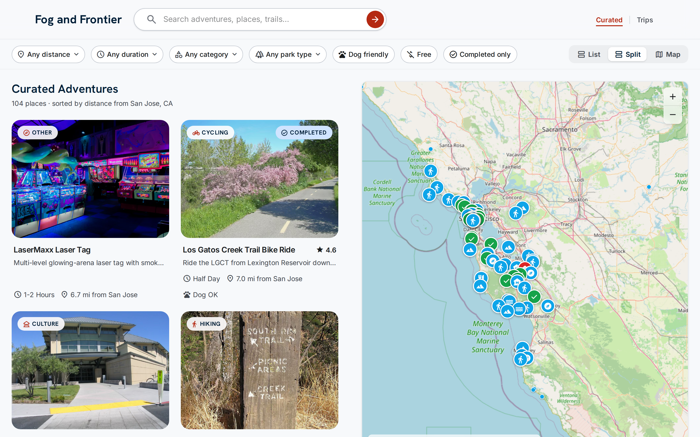
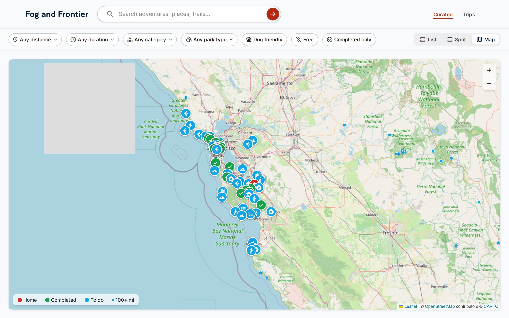
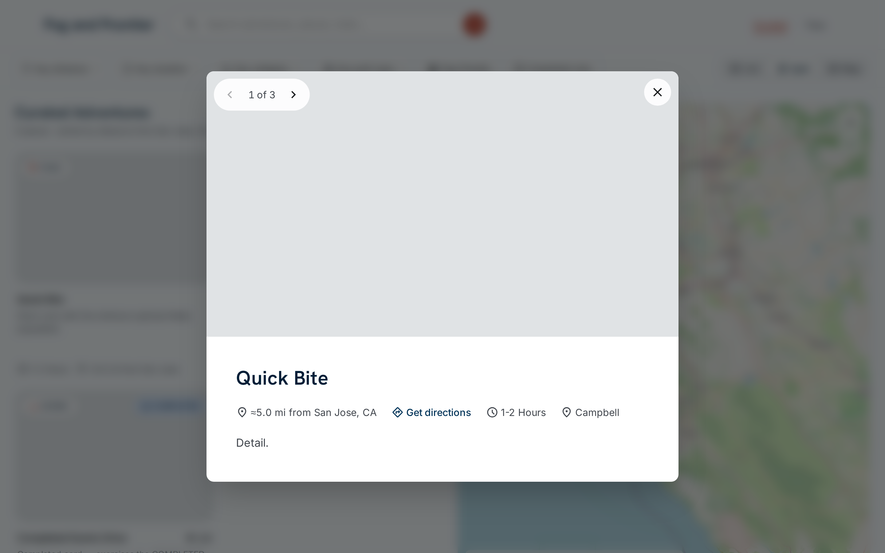
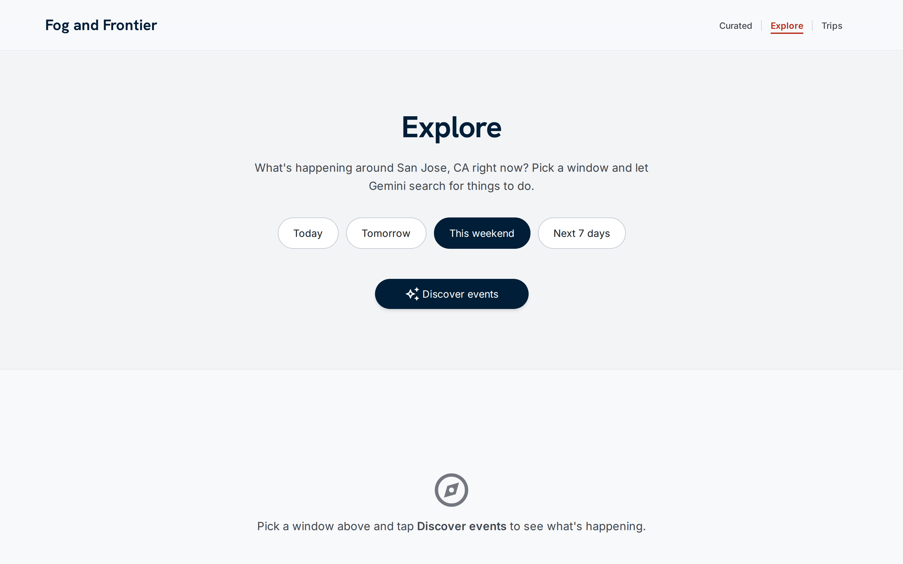
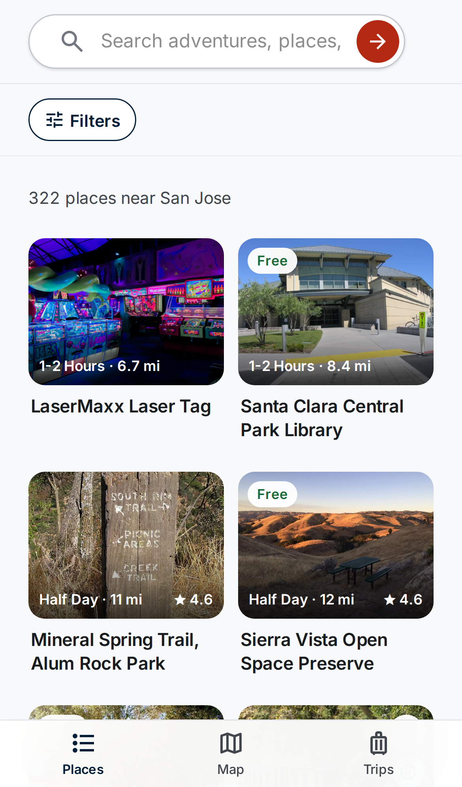
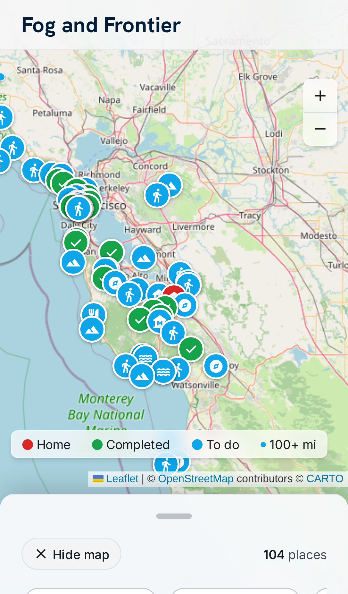

# Fog & Frontier

**A full-stack map-based tracker for Bay Area adventures — hikes, food, scenic
drives, and culture — with collaborative trip planning and AI-assisted
discovery.**

🌉 **Live demo: [fog-and-frontier.vercel.app](https://fog-and-frontier.vercel.app)**

React 19 + Vite front end · a single consolidated Apollo GraphQL serverless
function · Turso (libSQL) edge database · Clerk auth · Leaflet maps · Sentry
observability · Vitest + Playwright in CI.



## What it does

Fog & Frontier is a curated catalog of Bay Area outdoor activities you can browse,
map, filter, and plan trips around.

- **Browse & filter** a catalog of curated adventures — filter by distance from
  home, duration, category (hiking, cycling, water, food, culture, scenic,
  climbing, camping), park designation, dog-friendliness, and "Completed only"
  (the places you've already done). Results are sorted by distance.
- **Three synced views** — a segmented **List · Split · Map** toggle. Split view
  puts the catalog next to a live map; panning/zooming narrows the list to
  what's in view ("Showing N in this area"), and hovering a card highlights its
  map pin and vice-versa.
- **Interactive map** — Leaflet with a CARTO Positron basemap and custom circular
  glyph pins colored by completion status (to-do / completed) and iconed by
  category.
- **Activity detail** — rich detail cards with AllTrails ratings, trail
  stats, park type, and per-activity user photo uploads.
- **Trip planning** — create a trip, invite members, shortlist activities, and
  **vote**; trips move through a `voting → planning → past` lifecycle with a
  day-by-day itinerary (day index, start time, ordering).
- **AI discovery ("Explore")** — pick a date window (today / tomorrow / this
  weekend / next 7 days) and Google Gemini searches for local events to do.
- **Share from Instagram** — share a post or reel to the app and Gemini lists
  the places in it (from the caption, the geotag, and what's shown or said in
  the video), each added one at a time. For owners only. Android
  offers the installed app in its share sheet. On iPhone, where Safari can't
  receive shares, a Shortcut does it, made once in the Shortcuts app:
  1. New shortcut → in its details (ⓘ), turn on **Show in Share Sheet**, and
     set it to receive **URLs** (and Text) from the share sheet.
  2. Add **URL Encode** on the Shortcut Input.
  3. Add **Open URLs** with
     `https://fog-and-frontier.vercel.app/share?url=` followed by the URL
     Encoded Text.
  4. Name it "Fog and Frontier". In Instagram, Share → More → Fog and Frontier.

  It opens Safari, so sign in there once. Without the Shortcut, copy the
  post's link and paste it at `/share`.
- **Owner-gated editing** — add / edit / delete / mark-complete are gated to
  owners, **enforced server-side** (the client gate is a UI hint only).

## Screenshots

| Full-screen map | Activity detail |
| --- | --- |
|  |  |

**AI-assisted "Explore" — pick a date window and let Gemini find local events:**



| Mobile list | Mobile map |
| --- | --- |
|  |  |

## Tech stack

| Layer | Technology |
| --- | --- |
| **Front end** | React 19, Vite 8, TypeScript, React Router 7, Tailwind CSS v4 |
| **Maps** | Leaflet + react-leaflet, CARTO Positron basemap |
| **Data layer** | Apollo Client 4, GraphQL, `graphql-codegen` (typed operations) |
| **API** | Apollo Server 5 on Express 5, one Vercel serverless function |
| **Database** | Turso / libSQL edge database (`@libsql/client`) |
| **Auth** | Clerk (`@clerk/clerk-react` + `@clerk/backend`) |
| **AI** | Google Gemini (event discovery, activity generation, trip ideas) |
| **Observability** | Sentry (`@sentry/react`) with source-map upload; structured serverless logging |
| **Testing / CI** | Vitest (unit), Playwright (visual regression), GitHub Actions |
| **Hosting** | Vercel |

## Engineering highlights

A few things in here worth a closer look:

- **Schema-first GraphQL, one function.** Eleven REST endpoints were consolidated
  behind a single Apollo Server handler (`api/graphql.ts`) to stay under Vercel
  Hobby's 12-function cap — schema in `api/_schema.ts`, resolvers in
  `api/_resolvers/*`, typed end-to-end via `graphql-codegen`.
- **Auth you can't bypass from the client.** `requireOwnerCtx` (Clerk-backed,
  with `requireMemberCtx` / `requireCreatorCtx` for trips) gates every owner
  mutation and paid AI call server-side; the one exception is a signed-in
  account's suggestion and its capped Gemini draft (#73, `requireUserCtx`).
  The client `useOwner()` hook only decides what to *render*.
- **A production safety net born from an outage.** Earlier work shipped a bug that
  404'd the API and blanked the CSS in prod. The response — a **smoke gate**
  (canary checks against the real Vercel deployment, including detection of
  Vercel's no-build cached stubs) and **Playwright visual-regression** on desktop
  and mobile — is documented in [`PLAN.md`](./PLAN.md).
- **A strict, type-checked lint setup with a no-suppressions rule.** ESLint runs
  with type-aware rules, `jsx-a11y`, and import-cycle detection, and the project
  forbids `eslint-disable` / `@ts-ignore` outright. The debugging notes from
  honoring that rule live in [`CALIBER_LEARNINGS.md`](./CALIBER_LEARNINGS.md).
- **Privacy-conscious observability.** Sentry runs with `sendDefaultPii: false`,
  scrubs query strings from breadcrumbs and events, uploads hidden source maps to
  de-minify stack traces, and deletes them from the public bundle at build time.

## Getting started

```sh
npm ci                       # install exactly what package-lock.json pins
npm run dev                  # Vite dev server on http://localhost:5173
```

`npm run dev` serves the UI on port 5173 and needs no secrets to boot. The client
calls the GraphQL API at the relative path `/api/graphql`, so to develop against
live data run `vercel dev` (which serves the serverless function) with a
`.env.local` — see [`CONTRIBUTING.md`](./CONTRIBUTING.md). With no Clerk key set,
auth falls back to a public, signed-out mode (owner-only editing controls are
hidden).

Common scripts:

```sh
npm run lint         # ESLint + Stylelint
npm run typecheck    # tsc -b (app + node + api + eval projects)
npm run test         # Vitest unit tests
npm run test:visual  # Playwright visual regression
npm run eval         # Gemini output-quality eval (paid; needs GEMINI_API_KEY)
npm run build        # lint → typecheck → vite build
```

For the full developer guide — architecture, the multi-tsconfig layout, the
Sentry/observability wiring, CI details, and the lint policy — see
[`CONTRIBUTING.md`](./CONTRIBUTING.md).

## Output-quality evaluation (Gemini)

The Gemini calls are the one part of the app whose output a type-checker can't
vouch for — a well-formed response can still be wrong. `eval/` is a golden-set
harness (issue #122) that grades what the model actually returns across the
four AI surfaces:

- **`generateActivity`** — turning a title into a structured activity record.
- **`alltrailsLookup`** — pulling rating / distance / elevation for a trail.
- **`discover`** — the "Explore" event search over a date window.
- **`tripSuggestions`** — ranking catalog activities for a new trip's request
  (#78), graded over a fixed catalog: the picks must include a clear fit and
  nothing that breaks a hard constraint like "dogs" or "indoors".

Most of the grading is **mechanical and deterministic**: schema and enum
legality, expected-enum membership (category / region / park type / duration),
coordinate tolerance against a cited source, and the right graceful-failure
codes on adversarial input. On top of that sits a **narrow, search-grounded
LLM judge** used *only* for the things a check can't assert — the plausibility of a
generated description or a discovered event. Nothing else is judged by a model.

**Model and generation settings.** The resolvers call `gemini-3.8-flash` with
Google Search and URL context turned on, so they look facts up and read the
links they're given rather than answer from memory, and a JSON schema still
shapes every reply. Trip suggestions are the exception: they only choose from
the catalog they're given, so they search nothing. Issue #122 asked for temperature-0 eval calls; the harness
deliberately deviates and exercises the production resolvers at their
production settings — Gemini 3.8 Flash ignores temperature, and the search
results are live — so it measures what actually ships, not a determinized
variant of it. The trade-off is that individual case results rotate
run-to-run (typically ~1 case flips between otherwise-identical runs) while
the overall score stays in band, so compare runs by score, not by which case
failed. The judge runs on `gemini-3.8-flash` with Google Search too, so it
checks a specific the way the resolver found it rather than from memory.

**How to run:**

```sh
vercel env pull .env.local   # provides GEMINI_API_KEY
npm run eval
```

It makes 24 paid resolver calls (`gemini-3.8-flash`, most with a few Google
searches) plus up to 16 judge calls (also grounded `gemini-3.8-flash`) per
run — judges are skipped once a mechanical check has already failed a case,
so most runs use fewer. On 2.5 a run cost about $0.25 (26 CI runs made up most of a $6.59
month). Grounding makes it dearer — search results and fetched pages bill as
input tokens, though the first 5,000 searches a month are free — so expect
up to a dollar. It is **not** part of `npm test`: it's opt-in because it costs
money and hits the network.

**Threshold semantics.** A run passes at **90%** by default, overridable with
`EVAL_THRESHOLD` or `--threshold` — both take a fraction (e.g. `0.85`), not a
percentage. Infrastructure errors (transport failures, a
judge that dies after retry, per-case timeouts) are **excluded from the
denominator** so flaky infra can't fail the quality gate — but if they collapse
too much of the set, the run is reported **inconclusive** and exits non-zero
below an **80% graded floor**.

**CI.** `.github/workflows/eval.yml` grades only when the AI code — the
Gemini resolver (`api/_resolvers/gemini.ts`), its follow-up AllTrails
search (`api/_allTrailsSearch.ts`), the `api/_home.ts` and
`api/_gqlError.ts` it and the harness read, or `eval/**` — changes, and never a draft: when a PR opens ready for review, is reopened, or
a draft is marked ready, if the PR touches the AI code; and on a later push
to a ready PR, unless the AI code is as it was when the workflow last
finished a run on the PR and that run passed. So rebasing on, or merging in,
a `main` that moved doesn't re-grade, but a push after a failed, errored or
cancelled grade does.
`.github/scripts/eval-should-grade.mjs` makes the call. A manual dispatch
always grades; use one after changing the workflow itself, which doesn't
grade on its own. It used to run on every push to any PR that
touched the schema or the auth context too, which most feature PRs do, and
that ran into the project's monthly spend cap. There's no schedule (the calls
are paid), and it **skips green** when `GEMINI_API_KEY` is absent
(forks, or the secret unset), so it never blocks contributors who can't make the
calls.

**Golden set status.** The golden set is **DRAFT — pending owner review**; each
case cites the provenance of its expected coordinates/data and an as-of date.

**Known limitations.** The plausibility judge is Gemini grading Gemini (both
3.8 Flash). Its rubric was calibrated during owner review (2026-07-10) after
three consecutive runs each failed a *different* true-but-unlisted fact (Big
Basin's reservation system, Duarte's cioppino/1930s restaurant era, Castle
Rock's world-class climbing reputation): the judge passes widely-documented
famous attributes even when a case's notes omit them and fails anything
false/contradictory. Since 2026-10-14 it searches before it fails a specific
and fails only what search contradicts or can't support, so a true obscure
detail the grounded resolver found no longer fails as "unverifiable" (see
`eval/judge.ts`). Scores graded before then, by a 2.5 Flash judge without
search, aren't directly comparable. One case is marked `xfail` (expected
failure) to document that the response schema forces the model to fabricate a
record on pure-nonsense input rather than decline.

**Current score: 100%** (22/22 graded, before the two trip-suggestion cases were added; threshold 90%) on search-grounded
`gemini-3.8-flash`, graded by the search-grounded judge, 2026-10-14 (eval
workflow run 38511460561). Before the judge could search, the same resolvers
scored 95.5% (run 38501577212). The one difference is `gen-duartes-tavern`:
the memory-only judge failed true, documented details of the place (the
half-and-half artichoke-and-green-chile soup, the knotty-pine room, weekend
cioppino) as unverifiable, and the searching judge confirms them. A perfect
score from a more capable grader is worth watching rather than celebrating:
`gen-nonsense` still fabricates a record (counted via its `xfail`), and if the
judge ever passes a description a person would call wrong, the search-backed
rubric has become too lenient.

The first grounded run (90.9%, run 38489973906) also failed `gen-muir-woods`
on a **real model error**: its description put Bohemian Grove, a private club
in Sonoma County, inside Muir Woods. The prompt now lets a description name a
place or thing inside the activity only when a source the model found names
it there, and that case passed on the next run.

Because the resolvers are evaluated at their production settings (see above),
*which* case fails rotates run-to-run — the ≥90% threshold is the contract,
not any single case's verdict. The last 2.5 Flash score was 95.5% (21/22, run
29061551986, 2026-07-10). Findings from the 2.5 runs, reported as-is per issue
#122 ("failures are real signal"):

- On that run, `disc-week` failed `judge:events` (7/11 plausible) —
  a **judge bug, not a model finding**: lacking today's date, the judge graded
  events named "2026" as contradicting their own dates. Fixed since: the
  events judge now gets a "Today is <date>" preamble and each event's ISO
  `startDate`.
- Other runs have surfaced **genuine model findings** — e.g. `gen-muir-woods`
  failing `judge:descriptions` after the generated description called the
  trees "thousands of years old," when Muir Woods' oldest redwoods are ~1,200
  years (NPS). Left standing deliberately; enriching the case can't and
  shouldn't fix a model exaggeration.
- `gen-nonsense` fails as predicted on every run (counted via its `xfail`
  annotation): the response schema offers no refusal affordance, so the model
  fabricates a record for garbage input. Candidate follow-up: a
  refusal/uncertainty field in `ACTIVITY_SCHEMA`.

## Project structure

```
src/            React app — pages/, components/, lib/ (hooks + data layer), gql/ (generated)
api/            Apollo GraphQL serverless function — _schema.ts, _resolvers/*, _auth.ts, _db.ts
scripts/        DB snapshot / seed / migration helpers, CI smoke script
tests/visual/   Playwright visual-regression specs + baselines
docs/           Screenshots
```

## About

A personal project built and maintained with a
[Claude Code](https://claude.com/claude-code) workflow — see
[`CLAUDE.md`](./CLAUDE.md) for the working conventions and
[`CALIBER_LEARNINGS.md`](./CALIBER_LEARNINGS.md) for accumulated engineering
notes.
