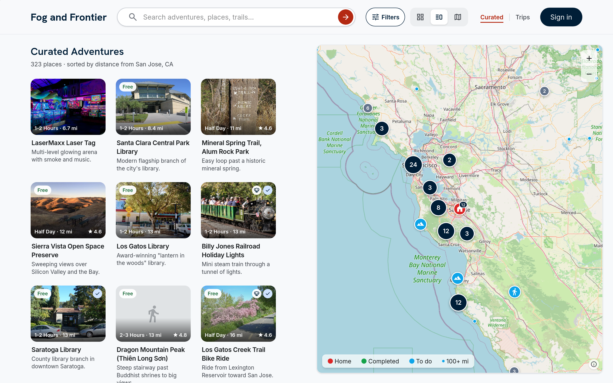
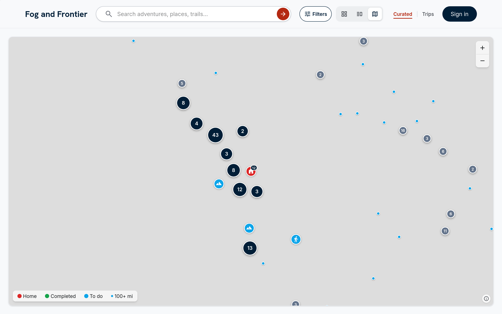
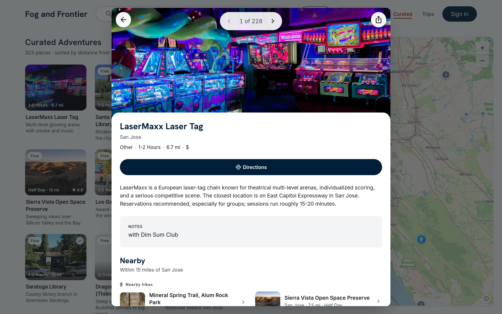
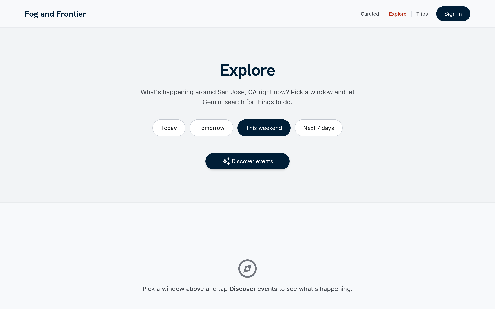
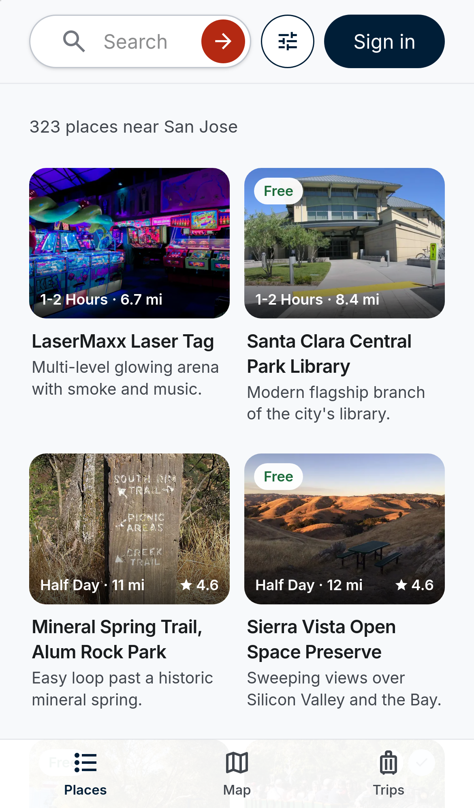
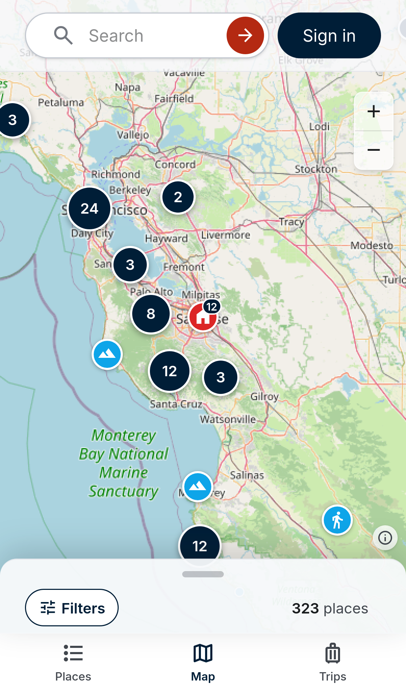

# Fog & Frontier

**A map-based tracker for West Coast adventures (hikes, food, scenic drives and culture) with
collaborative trip planning and AI-assisted discovery.**

🌉 **Live: [fog-and-frontier.vercel.app](https://fog-and-frontier.vercel.app)**

## What it does

- **Browse and filter** a curated catalog: by distance from home (road miles), duration, category
  (hiking, cycling, water, food, culture, scenic, climbing, camping), park designation,
  dog-friendliness, who added it and "Completed only", sorted by distance.
- **Three synced views**, List, Split and Map. Split puts the catalog beside a live map: panning
  and zooming narrows the list to what's in view, and hovering a card highlights its pin and the
  other way round.
- **An interactive map** with circular glyph pins, coloured by completion and iconed by category,
  grouped where they crowd.
- **Activity detail** with AllTrails ratings, trail stats, park type, reviews and the owners'
  photos.
- **Trip planning**: create a trip, invite members, shortlist activities and **vote**; a trip
  moves through `voting → planning → past` with a day-by-day itinerary.
- **AI discovery ("Explore")**: pick a date window (today, tomorrow, this weekend, the next seven
  days) and Google Gemini searches for local events.
- **Suggestions**: any signed-in account can suggest an activity, drafted by Gemini or by hand,
  for the owners to accept or reject.
- **Share from Instagram**: share a post or reel to the app and Gemini lists the places in it
  (from the caption, the geotag and what the video shows or says), each added one at a time. For
  owners only. Android offers the installed app in its share sheet. On iPhone, where Safari can't
  receive shares, a Shortcut does it, made once in the Shortcuts app:
  1. New shortcut → in its details (ⓘ), turn on **Show in Share Sheet**, and set it to receive
     **URLs** (and Text) from the share sheet.
  2. Add **URL Encode** on the Shortcut Input.
  3. Add **Open URLs** with `https://fog-and-frontier.vercel.app/share?url=` followed by the URL
     Encoded Text.
  4. Name it "Fog and Frontier". In Instagram, Share → More → Fog and Frontier.

  It opens Safari, so sign in there once. Without the Shortcut, copy the post's link and paste it
  at `/share`.

## Screenshots

| Full-screen map                                                                         | Activity detail                                                                                           |
| --------------------------------------------------------------------------------------- | --------------------------------------------------------------------------------------------------------- |
|  |  |

**AI-assisted "Explore": pick a date window and let Gemini find local events.**

| Mobile list                                                                     | Mobile map                                                                    |
| ------------------------------------------------------------------------------- | ----------------------------------------------------------------------------- |
|  |  |

The screenshots retake themselves when a change to what they show merges.

## Technologies, and what each gives it

- **React 19, TypeScript (strict) and Vite 8, with React Router 7 and Tailwind CSS 4:** a fast
  single-page app with every value typed (type coverage at 100%, no `any`) and every style a
  linted class from one set of tokens.
- **Leaflet (react-leaflet)** with a CARTO Positron basemap: the maps, with one shared pin and
  basemap treatment across the app.
- **GraphQL: Apollo Server 5 on Express 5, in one Vercel function, and Apollo Client 4 with
  `graphql-codegen`:** one schema-first API, typed end to end, inside Vercel Hobby's function cap
  (eleven REST endpoints were consolidated behind it).
- **Turso (libSQL):** the catalog, trips, reviews, suggestions and sessions, in one edge
  database, with a local SQLite snapshot for development.
- **Better Auth:** sign-in with Google (and One Tap), Apple and passkeys, as an HttpOnly session
  cookie on the site's own origin, so nothing waits on a sign-in service before the first read.
- **Google Gemini:** activity drafts, event discovery, trip ideas and reading shared Instagram
  posts, grounded in Google Search, with a hike's AllTrails page found by an Agent Search app.
- **Vercel Blob and Vercel's image CDN:** the owners' private photos, and cover photos resized
  and cached per card.
- **OpenRouteService:** road miles from home, under an hourly budget.
- **Sentry:** browser errors and tracing, with query strings scrubbed from every captured URL and
  hidden source maps uploaded at build time and removed from the public bundle; the API logs one
  JSON line per failure, never a body or a key, for Vercel's observability.
- **Vitest, React Testing Library, fast-check and StrykerJS:** unit, component and property tests
  under an 80% per-file coverage gate, and mutation testing that checks the tests would fail if
  the code changed.
- **Playwright:** visual regression of the desktop pages in Chromium, Firefox and WebKit and the
  mobile ones on an iPhone.

## Architecture

- **`src/`, the app:** the pages (`src/pages/`), components (`src/components/`), hooks and pure
  helpers (`src/lib/`), the Activity model (`src/data/`) and the generated GraphQL operations
  (`src/gql/`).
- **`api/`, the one function:** the GraphQL handler (`api/graphql.ts`), its schema and resolvers,
  sign-in at `/api/auth/*`, and the server-side gates every write and paid call passes through.
- **`shared/`:** the data both sides read (regions), since the app and the API never import each
  other.
- **`eval/`:** a golden-set harness that grades what Gemini actually returns.
- **`scripts/`:** the smoke gate, database snapshot and seed helpers, the card-copy and region
  generators, the link and Instagram audits, and the PR GIF and README screenshot recorders.
- **`tests/visual/`:** the Playwright visual-regression specs and their baselines.

## Built to be trusted

- **Auth you can't bypass from the client.** Every owner write and paid AI call is gated on the
  server; the client's owner check only decides what to render, and owner-only controls are
  hidden rather than greyed out. A signed-in account's suggestion, and its Gemini draft under a
  daily cap, is the one exception.
- **A production safety net born from an outage.** A lint change once shipped a build that 404'd
  the API and blanked the CSS in production. The response was a **smoke gate** (canary checks
  against each real Vercel deployment, catching its no-build cached stubs; #10), a local snapshot
  of production's data (#11) and **visual regression** on desktop and mobile (#12).
- **No suppressions.** ESLint runs type-aware with `jsx-a11y` and import-cycle detection, and the
  project forbids `eslint-disable` and `@ts-ignore` outright.
- **Gemini's answers are measured.** A golden set of cases, each citing its source, grades the
  drafts, the AllTrails lookups, event discovery and trip suggestions, mostly with deterministic
  checks and a narrow search-grounded judge only for what a check can't assert; a run passes at
  90%. The latest full run scored 100% (22/22 graded, 2026-10-14).
- **Weekly sweeps**: every outbound link in the live catalog, the Instagram pages sharing reads,
  unused code and duplication.

Working on it: [`CONTRIBUTING.md`](CONTRIBUTING.md). Built and maintained with a
[Claude Code](https://claude.com/claude-code) workflow.
